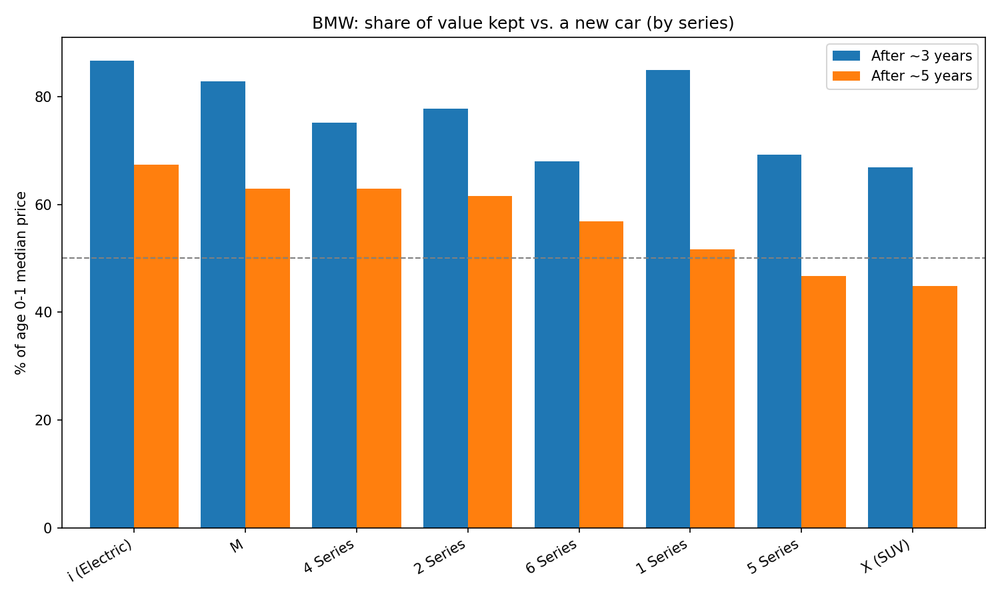
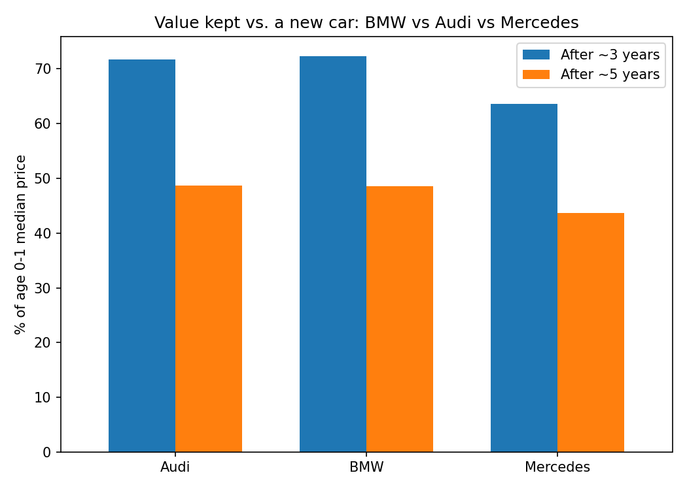
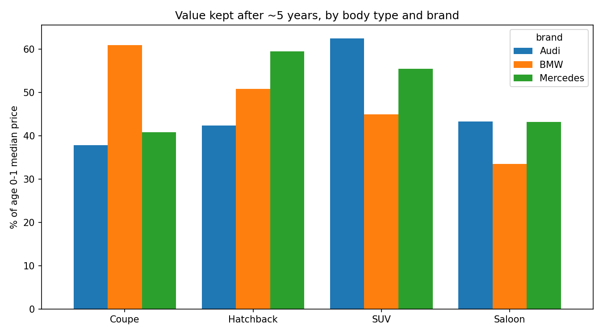
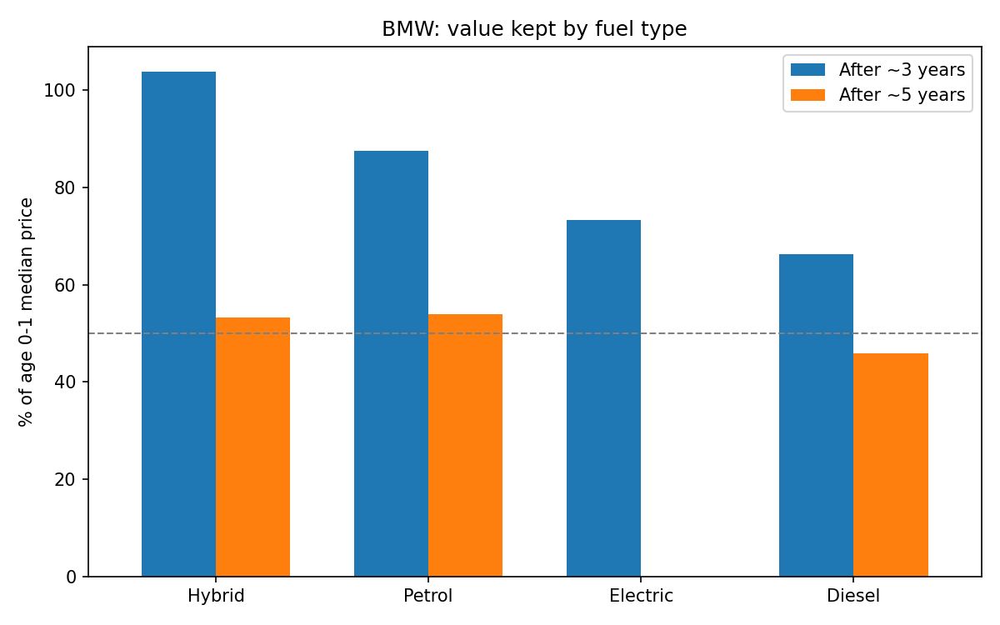
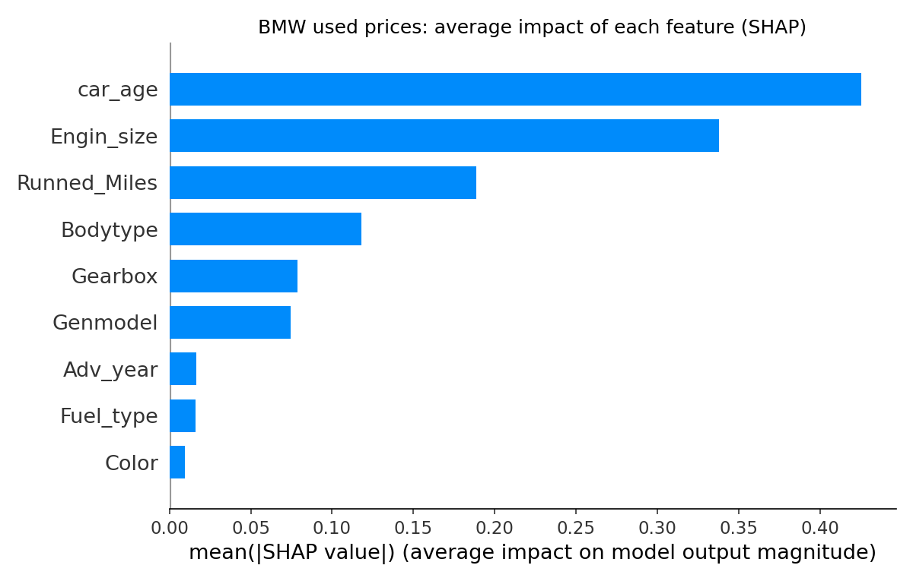
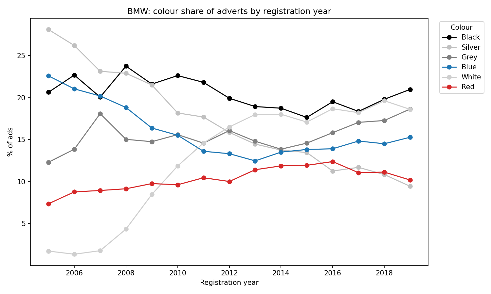

# BMW Used Car Value Analysis (UK)

Which BMW models hold their value, how do they compare with Audi and Mercedes, and what drives used prices? This project explores UK used-car adverts from the DVM-CAR dataset, with a focus on **residual value**: the share of a new car's price that remains after a few years, which feeds directly into lease and finance pricing.

## Dataset
**DVM-CAR** (UK): a public automotive dataset of used-car adverts, sales figures and prices, split into six tables:

| Table | Content |
|---|---|
| `Ad_table` | Individual used-car adverts (the main table used here) |
| `Basic_table` | Maker and model IDs |
| `Price_table` | Entry (new) price per model and year |
| `Sales_table` | Annual sales per model, 2001-2020 |
| `Trim_table` | Trim-level price, emissions and engine data |
| `Image_table` | Image metadata (not used) |

**Columns used from `Ad_table`:** `Maker`, `Genmodel`, `Adv_year`, `Reg_year`, `Color`, `Bodytype`, `Runned_Miles`, `Engin_size`, `Gearbox`, `Fuel_type`, `Price`. I derived `car_age = Adv_year - Reg_year`.

**Cleaning:** kept cars aged 0-15 years, priced above £500, with 0-200,000 miles; removed rare collectible models (Z3 M, Z4 M, Z8) that distort price curves; grouped models into series (1 Series, X, M, etc.).

*Note: an attempt to forecast sales per model with time-series methods was dropped. Each model has only ~20 annual data points and 2020 is a COVID shock, so I used the data descriptively instead.*

## Residual value: how well do BMWs hold their value?

I compared the median asking price of cars at age 0-1 with cars aged about 3 and 5 years to estimate how much value each model keeps (data: DVM-CAR, UK adverts).

### BMW by series

Electric (i) and M models hold their value best, while X (SUV) and 5 Series lose the most. 3 Series and Z are excluded because the dataset has too few ads at the relevant ages.

### BMW vs Audi vs Mercedes

Overall, BMW and Audi are level (about 49% of the new price kept after 5 years), with Mercedes slightly behind (44%).

The overall tie hides differences within body types. BMW leads among coupes (61% vs. 41-38%), but trails in SUVs (45% vs. 62% for Audi) and saloons (33% vs. 43%). So BMW's weakest spot is its volume segments, which matters most for leasing and residual value pricing.

### Limitations
- Prices are advertised asking prices, not sale prices.
- Cars of different ages are different model years, so the results mix depreciation with generation changes.
- Body types group cars of different price levels, so the comparison is approximate, not like for like.
- Groups with fewer than 30 ads at a given age were excluded.

### Business implications
Residual value drives lease and finance pricing: the lower the expected value at the end of a contract, the higher the monthly payment. In this data, BMW's SUVs (45% retained after 5 years vs. 62% for Audi) and saloons (33% vs. 43%) are the weakest spots, and these are high-volume segments where overly optimistic residual assumptions would be costly. Coupes, M and i models retain value best, so they are lower-risk candidates for promotional finance offers. Since the data are asking prices from UK adverts, these results are indicators for further investigation, not residual value forecasts.

### Retention by fuel type

Diesel BMWs retain the least value (46% after 5 years), compared with about 54% for petrol. Since diesels in this data skew towards larger cars such as 5 Series and X models, part of this gap reflects the model mix and not the fuel alone. Hybrid and electric results are based on very few ads at the relevant ages (41 hybrids and 26 electric cars at ages 4-6), so they should not be interpreted: the hybrid figure above 100% at 3 years most likely reflects which models happen to be in the sample, and electric has no reliable 5-year estimate.

## What drives used BMW prices?

I trained an XGBoost model on log price using age, mileage, engine size, body type, gearbox, fuel type, model, advert year and colour, then used SHAP to measure how much each feature moves the predicted price. The model fits well (R² = 0.955, median absolute error ≈ £920 on a held-out 20% of ads), so its feature rankings can be taken as a reasonable summary of the data.

- **Age is the biggest driver**, followed by **engine size** (a proxy for power and trim level) and **mileage**. Together they explain most of the price differences.
- **Body type and gearbox** come next, with a smaller but noticeable effect.
- **Model name has a low score**, but this is because engine size and body type already capture most of what distinguishes models, so the importance is shared between correlated features.
- **Fuel type, advert year and colour matter least.** Colour is the weakest of all, which is consistent with colour having only a small price premium once the car itself is accounted for.

*Note: SHAP importance describes associations in asking prices, not causal effects. Categorical features are integer-coded, so the chart shows how much a feature matters, not which category pays a premium.*

## Colour trends: white overtook silver

The share of adverts by colour changed a lot between 2005 and 2019. **White** went from almost nothing (~2% of ads for 2005 registrations) to one of the most common colours (~19%), while **silver** fell from the most popular colour (~28%) to under 10%. **Blue** declined from ~22% to around 13-15%, **grey** grew from ~12% to ~19%, and **black** stayed consistently popular at about 18-23%. Colour matters little for price: it is the weakest feature in the price model below.

*Shares are among the six most common colours, so they don't sum to 100%.*

## Residual value by BMW series

Retention is the median asking price of cars aged ~3 and ~5 years as a percentage of the median price of cars aged 0-1.

- **Best at holding value:** the electric **i** models (87% after 3 years, 67% after 5) and **M** cars (83% / 63%), followed by the 4 and 2 Series.
- **Worst:** **X (SUV)** and **5 Series** keep under 50% after 5 years.
- **1 Series** looks strong at 3 years (85%) but falls the most between years 3 and 5, ending near 52%.
- 3 Series and Z are excluded because the dataset has too few ads at the relevant ages.

*The i series result rests on a small number of early models, so treat it as indicative.*

## Tools
Python, pandas, matplotlib, seaborn, statsmodels, XGBoost, SHAP.